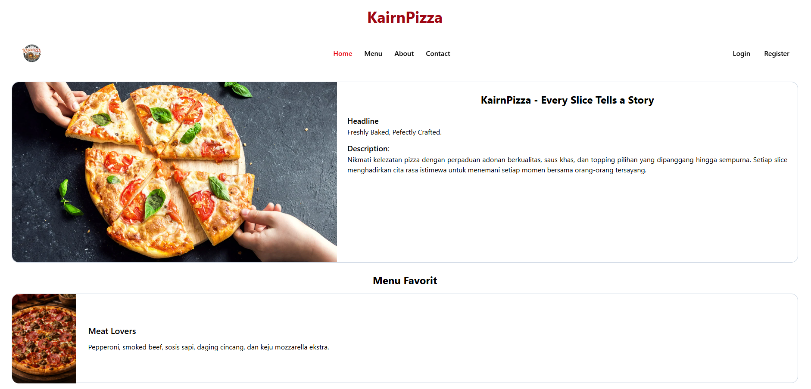
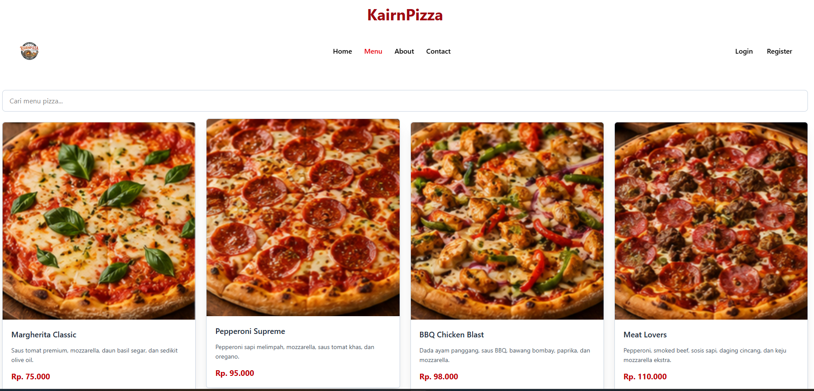
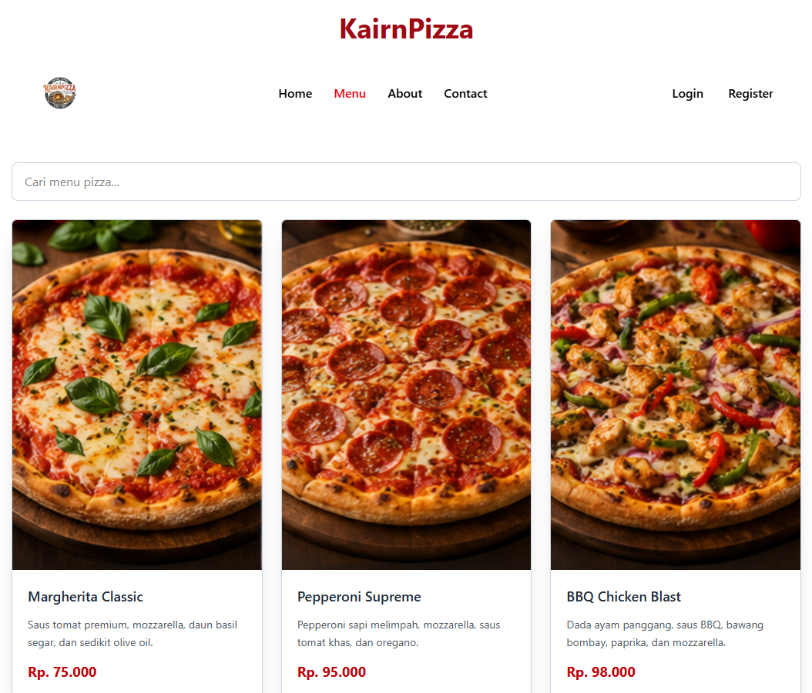
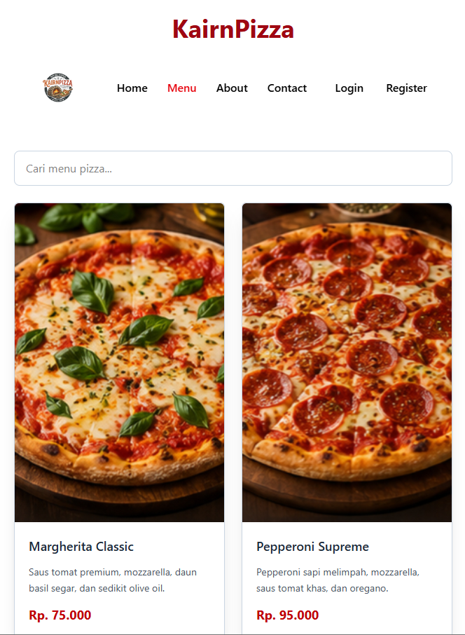
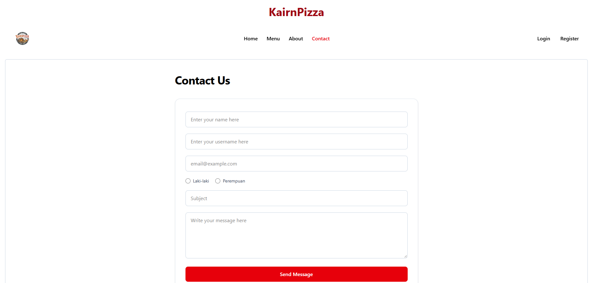
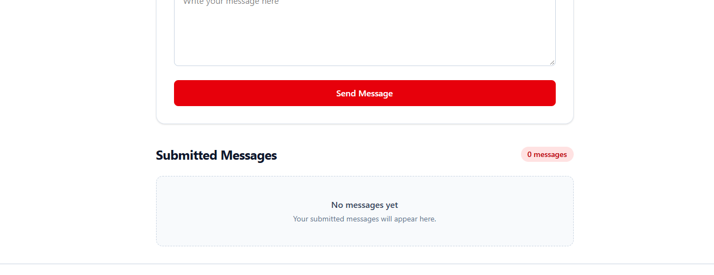

# KairnPizza

## Website Description

KairnPizza adalah website restoran pizza sederhana dimana user bisa melihat homepage, list menu, dan mengajukan aduan (form)

## Screenshot
### Home

### Menu

### Contact

## How the Website Works

- Menggunakan navigasi untuk mengunjungi halaman utama, menu, about, dan kontak.
- Di halaman menu, kita bisa melakukan pencarian untuk pizza yang diinginkan.
- Di halaman kontak, kita bisa mengirimkan form, yang dimana akan disimpan didalam localstorage. Lalu ditampilkan di bagian bawah halaman, kita bisa juga menghapus pesan yang kita inginkan menggunakan tombol delete.

## How to Run

1. Install react dengan `npm create vite@latest`
2. Install tailwind dengan `npm install tailwindcss @tailwindcss/vite`
3. Install react router dom dengan `npm install react-router-dom`
4. Jalankan dengan `npm run dev` di terminal
